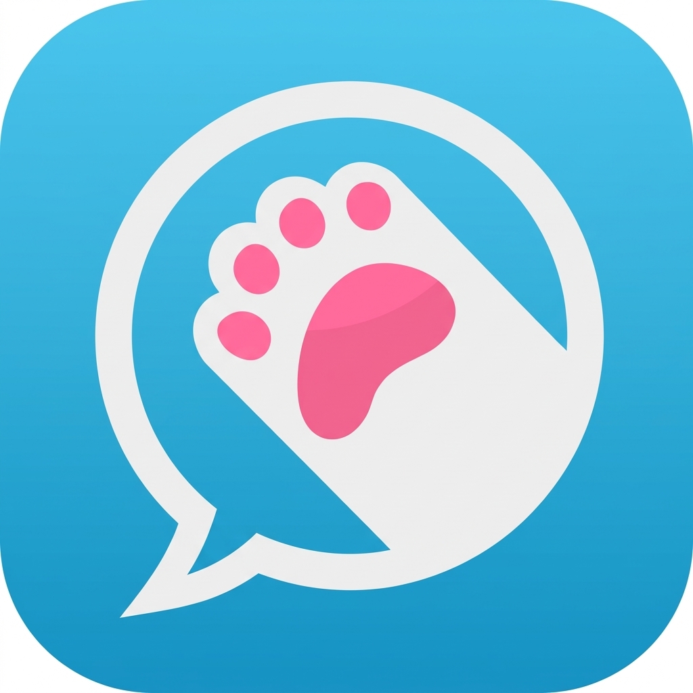

# peta

## 製品概要
自分のAIペットを、猫のように放し飼いして、その様子を楽しむことができるアプリです。
ペットを可愛がってくれる人との交流が生まれたり、ペットを飼っている人同士のコミュニティが生まれることが狙いです。

### 背景(製品開発のきっかけ、課題等）
SNSには、初心者にとって様々な壁があります。
初めに投稿するのが難しい。内容に気を使わないと炎上しそう。出来上がったコミュニティには入りずらい...などなど。
その結果、見る専門になって人との繋がりが生まれなかったり、楽しくなく飽きてしまったりします。
そこで私たちは、かわいいペットが老若男女全ての人を癒し、さらにはペット界隈なんてものもできていることに着目し、SNS上でペットを飼うことができるアプリを作成しました。
このペットは、最初の壁がとても薄く、かつみんなに愛される存在になって、新しい風を吹かせることができます。

### 製品説明（具体的な製品の説明）
skyblueというSNSに、自分のペットを放し飼いすることができます。
自分でペットの特徴を指定して簡単に作成、それからペットの意思で遊んだり、面白い投稿をしたりします。

### 特長
#### 1. AIがSNS運用
これ自体は新規制はありませんが、AIが人間たちに愛される存在になれることは、これまでいろんな人が証明してきました。
なので、自分のAIペットが人気をとれるかもしれないという期待を得るには、十分な要素が整っています。
そしてAIが人気が出た暁には、AIを作った自分が、人気になれるかもしれないというわくわくがあります。
それらが、このアプリを使おうというモチベーションに繋がるでしょう。

#### 2. 自分のペット
ペットというのは、新たな家族、あるいは自分を癒してくれる相棒的な存在になります。
自分の子が頑張ってる！自分の子が遊んでる！バズってる！のような感情は、新たに自分のSNSのモチベーションにも繋がると考えています。
そういった感情は、共有したくなりますよね？

#### 3. 舞台が普通のSNS
早い話、誰でも接しやすいということです。
SNSはきっかけがあれば、1日に何十件も投稿する人がいるほど手軽ですから。
ペットの何気ない投稿に人が反応し、そこで輪ができて、ペットが増えて、輪が広がって、という、良い循環が生まれることを期待しています。

### 解決出来ること
SNSをやっておらず、人との関わりが薄くなっている人にとって、簡単に始められ、かつ新しい関わりが生まれる機会ができます。
このアプリは、そんな小さなところから始まって、少しずつ大きくなり、やがて新しい流行になるでしょう。

### 今後の展望
せっかくのペットなので、愛着が持てる仕組みをもっと作りたいなと考えています。
また、完全に放し飼いでは制御できなくなるので、躾をする機能もつけたいです。

### 注力したこと（こだわり等）
* AIをペットとして表現することで、流れをわかりやすく
* 個性を簡単に設定し、AIが個性を持った投稿をするようにプロンプトを設定

## 開発技術
### 活用した技術
#### API・データ
* Bluesky API
* SQLite
* Gemini API

#### フレームワーク・ライブラリ・モジュール
バックエンド
* Node.js
* Express

フロントエンド
* React + Vite

### 独自技術
#### ハッカソンで開発した独自機能・技術
* AT Protocolのレコードによるペット設定の保存
* 通常アカウントを擬似的にbotとして管理